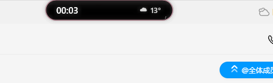
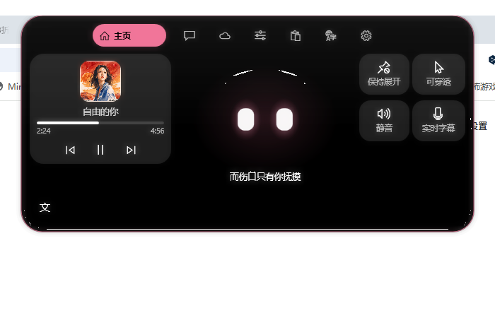

# Wisland · C# 重写版

用 **C# / .NET 8 + WPF** 重写 [AsamiAkito/wisland](https://github.com/AsamiAkito/wisland)（原版：Python + PySide6，MIT）的 Windows 桌面「液态灵动岛」。

<p align="center">
&nbsp;&nbsp;

</p>

> 当前版本 **v0.1.0**（Releases 上的构建）；主线已到 **0.2.0**：插件系统、天气城市选择、消息与启动栏增强。

## 下载

到 [Releases](https://github.com/Heacter233/wisland-csharp/releases) 下载，两个包选一个：

| 包 | 大小 | 说明 |
| --- | --- | --- |
| `wisland-csharp-0.1.0-portable-x64.zip` | ~70 MB | **自带 .NET 运行库，解压即用**，不需要装任何东西 |
| `wisland-csharp-0.1.0-slim-x64.zip` | ~7.5 MB | 体积小，但需要先装 [.NET 8 桌面运行时](https://dotnet.microsoft.com/download/dotnet/8.0) |

双击 `Wisland.exe` 即可。首次运行会在 exe 同目录生成 `config.json` 与 `data\`；卸载直接删除文件夹（程序不写注册表，仅"开机自启"开关会登记启动项，可在设置页关闭）。

## 插件开发

插件放在 `plugins/<id>/`（`plugin.json` + 程序集），宿主启动时校验清单、按插件隔离加载，
并在设置页展示状态、权限与插件自带的设置面板。

插件可选择性地注册**自己的页面**：图标会出现在主导航下方的独立一行（插件多时横向滚动），
不注册页面的插件不会占用这一行，其他元素位置保持不变。

- 完整规范（清单字段、权限表、禁止事项、界面写法）：**[docs/plugins.md](docs/plugins.md)**
- 清单 JSON Schema：`docs/plugin.schema.json`
- 示例插件：[`samples/`](samples) —— 三个可运行样板 + Clash 测试替身

| 示例 | 能力 |
| --- | --- |
| [`samples/hello-plugin`](samples/hello-plugin) | 最小骨架：设置面板 / 插件页 / 消息推送 / 宿主定时器 |
| [`samples/stock-plugin`](samples/stock-plugin) | 真实第三方数据：自选股增删、大盘指数、分时与日 K 迷你图、涨跌提醒、多域名切换 + 磁盘缓存 |
| [`samples/clash-plugin`](samples/clash-plugin) | 本机服务控制：代理模式切换、策略组节点切换，**HTTP 与命名管道双通道**（自动回退） |
| [`samples/mock`](samples/mock) | 没有 Clash 时用来验证插件：HTTP mock 与命名管道 mock |

## 关于本项目

- 原项目是贴在屏幕边缘的液态毛玻璃胶囊，悬停弹性展开，功能覆盖媒体控制、天气、控制中心、剪贴板、消息、翻译等。
- 本项目目标是**用 WPF 自绘**在 C# 里复刻同样的交互与观感：无边框窗口 + 透明分层 + 自定义绘制 + 阻尼弹簧动画，而不是套用现成控件库。
- 协议：**MIT**（与原项目一致）。

技术栈：`.NET 8` + `WPF`，目标框架 `net8.0-windows10.0.19041.0`（用 WinRT 的 SMTC / 通知 / Radio API）。

## 与原项目的功能对照

图例：✅ 成功复现　⚠️ 复现但不完美　❌ 未实现

| 模块 | 状态 | 说明 |
| --- | --- | --- |
| 灵动岛窗口 / 展开收起 | ✅ | 欠阻尼弹簧回弹、按压挤压、贴边吸附、拖动换边、展开态按住拖动会收起到指针下方 |
| 收起态（时钟 / 小形象 / 音乐） | ✅ | 滚轮切换视图；音乐态显示滚动歌词 |
| 小形象 | ✅ | 发光双眼跟随鼠标、多种表情、眨眼 |
| 播放控制 | ✅ | 走系统 SMTC（WinRT），无 SMTC 时退回媒体键 |
| 歌词 | ✅ | 网易云公开接口，含译文行 |
| 天气 | ✅ | Open-Meteo，多城市切换（**候选列表可选同名地点 / 支持坐标直填**）、逐小时 + 5 天预报 |
| 控制中心 | ✅ | 音量（CoreAudio）、亮度（WMI）、WLAN / 蓝牙（Radio API） |
| 剪贴板 | ✅ | 文本 + 图片缩略图、内容哈希去重、可置顶 / 删除 / 复制 |
| 消息 | ✅ | 解析 Windows 通知数据库 `wpndatabase.db`（QQ / 微信 / 邮件），不读消息正文 |
| 翻译 | ✅ | DeepSeek 流式接口，文本翻译 + 实时字幕接线 |
| 单词本 | ✅ | 本地 JSON 持久化 |
| 设置界面 | ✅ | `config.json` 可视化卡片，分组 + 自动保存 |
| 托盘 / 热键 / 主题 / 单实例 | ✅ | 深色 / 浅色 ⚠️**目前不要使用浅色主题**，目前未做浅色主题底板适配。/ 胭脂 / 天青 + auto |
| 实时字幕 | ⚠️ | 依赖外部 ASR sidecar，C# 侧尚未完全自足 |
| 液态形变（液桥 / 拉丝 / 贴边内凹圆角） | ❌ | 当前只有弹簧缩放与按压挤压，逐帧几何建模未移植 |
| Anki 同步 | ❌ | 单词本只存本地，未接入 Anki |
| 股票行情 | ✅ | **通过示例插件实现**（`samples/stock-plugin`）：自选股、大盘指数、分时/日K 迷你图、涨跌提醒 |
| Clash 代理控制 | ✅ | **通过示例插件实现**（`samples/clash-plugin`）：模式切换、策略组节点切换，支持 HTTP 与命名管道 |
| 插件系统 | ✅ | 清单校验 + 独立 AssemblyLoadContext 加载 + 权限守门 + 设置面板与插件页挂载 + 异常隔离；规范见 [docs/plugins.md](docs/plugins.md) |

## 新增功能（原版没有）

### 1. 三种可切换的毛玻璃模式（`island.glass`）

| 模式 | 效果 | 取舍 |
| --- | --- | --- |
| `system` | DWM accent 实时模糊 | 玻璃内容**实时**跟随桌面；但模糊作用域是窗口矩形，四角需靠小圆角（`glass_corner`）规避 |
| `capture` | 抓屏模糊 | 形状完美贴合药丸，但玻璃内容**定格**在最后一次抓屏（视频/游戏场景是旧画面） |
| `solid` | 实色，无模糊 | 近不透明、性能最好 |

### 2. 插件消息推送接口

```csharp
ServiceHub.Inbox.Push(new PluginMessage {
    Source = "clash", SourceName = "Clash",
    Title = "规则已更新", Body = "订阅已同步，共 1284 条规则",
    Level = "info",                    // info / warn / error → 蓝 / 黄 / 红
    IconGlyph = "\uE774", IconColor = "#E8544E",   // 自定义图标
    Uri = "https://example.com",       // 点击打开
    Action = () => DoSomething(),      // 或进程内回调
    NotifyDraw = (dc, rect, t) => { }, // 收起态自定义动画
    NotifyImage = @"C:\a.png",         // 或图片
});
```
线程安全，`Changed` 事件回到 UI 线程刷新；未读数、磁贴、已读、跳转全部自动生效。

### 3. 消息页重做

- **动态磁贴**：内置 QQ / 微信 / 邮件固定在最前，插件来源自动生成磁贴（未读数 + 最近时间 + 自定义图标）
- **两行视口 + 滚轮查找**：来源多了不会撑爆页面
- **右键置顶**（持久化到 `island.msg_pinned`）
- **折叠分页**：默认 5 条 + 「显示全部（共 N 条）」
- **点击跳转**：`Uri` / `Action`；内置类型顺带打开对应程序
- **全部已读**：标记已读（保留历史）而不是删除

### 4. 收起态新消息提示

- **绿点**：有新消息时右上角显示
- **弹出模式**：胶囊加高，最多 3 行，超出顶掉最旧，逐条按时收起
- **滚动模式**：胶囊加宽，在新增区域横向滚动
- 停留时长可配（`island.notify_duration_ms`）
- 插件可用 `NotifyDraw` / `NotifyImage` 自带动画与图片，可用 `island.notify_plugin_anim = false` 一律禁用

### 5. 系统通知统一进 Inbox

`island.notify_to_inbox`（默认开）：把 QQ / 微信 / 邮件 的系统通知镜像进 Inbox，
与插件消息共用磁贴、折叠、置顶、点击跳转。

### 6. 快捷启动栏

- 行尾 **`+`**：添加程序 / 文件 / 文件夹（文件夹用 `OpenFolderDialog`）
- **真实图标**：程序与文件取 shell 关联图标，文件夹取文件夹图标并显示**本地化名称**（Desktop → 桌面）
- **右键菜单**：置顶 / 启动参数 / 自定义图标 / 移除
- **拖拽排序**、**拖文件到岛自动展开并添加**、单行容器**滚轮横滑**

### 7. 点击磁贴打开程序

运行中的程序 → **唤出窗口并聚焦**（支持最小化到托盘）；未运行才启动。
按「配置路径 → 运行中进程 → 已知安装路径 → 开始菜单快捷方式 → 卸载注册表 → URI 协议」逐级兜底，
结果记录在 `data/app-launch.log`。

### 8. 插件系统（清单 / 权限 / 页面）

- **清单校验**：`plugin.json` 的 `id` 必须等于目录名、`minHostVersion` 不满足直接拒绝、
  权限名拼错也会拒绝加载，失败原因显示在设置页
- **隔离加载**：每个插件一个可回收 `AssemblyLoadContext`，第三方依赖只在插件目录解析，
  宿主/系统程序集回落到默认上下文（保证契约类型同一份）
- **容错**：`OnLoad` 后台执行 + 8 秒超时，抛异常/超时只标记该插件失败，不影响宿主与其他插件
- **权限守门**：`messages.push` / `ui.settings` / `ui.page` / `ui.compact` / `notify.image`
  未声明则对应调用被拒绝并记日志
- **插件页**：可选注册，图标出现在主导航下方一行（多插件横向滚动），无插件时该行不占高度
- **开发者体验**：宿主托管定时器（卸载自动释放）、插件独立配置与日志、
  设置页可直接打开插件目录/数据目录、失败原因与日志路径一目了然

### 9. 天气城市选择

同名地点极多（搜「朝阳」有 16 个，含国外同名点），而且地级市在地名库里常以「朝阳市」形式存在。
所以添加城市不再是"取第一个结果"：

- 自动补「原名 + 市」再合并去重，按**行政级别 + 人口 + 本国**加权排序
- 多个候选时弹出选择面板：每条显示 **城市 · 省份 · 国家 + 坐标 + 人口**，首条标「推荐」
- 单候选直接添加；也支持直接输入坐标（`30.66,104.06`，容忍全角符号）
- 添加后按坐标 0.05° 去重，chip 显示为 `朝阳市 · 辽宁`，一眼可分辨

## 操作

| 操作 | 效果 |
| --- | --- |
| 悬停 | 展开（回到上次页面） |
| 鼠标离开 | 收起 |
| 展开态按住空白处 0.3 秒拖动 | 收起到指针下方并拖动，松手吸附最近边 |
| 收起态滚轮 | 切换 时钟 / 小形象 / 音乐 视图 |
| 展开态点导航图标 | 切换页面 |
| 拖动文件到岛 | 自动展开并加入启动栏 |
| 启动栏内拖动图标 | 排序 |

## 配置要点（`config.json`）

| 键 | 说明 |
| --- | --- |
| `island.glass` | `system` / `capture` / `solid` |
| `island.glass_corner` | DWM 模式圆角半径（默认 14，越大越圆） |
| `island.glass_fog` | 四角雾化 0~255（默认 0） |
| `island.notify_style` | `popup` / `ticker` |
| `island.notify_duration_ms` | 每条提示停留时长 |
| `island.notify_to_inbox` | 系统通知是否并入消息页 |
| `island.notify_plugin_anim` | 是否允许插件自定义通知动画 |
| `island.msg_pinned` | 消息磁贴置顶的来源（逗号分隔） |
| `notify.open.qq` / `wechat` / `mail` | 点磁贴打开的 exe；留空自动探测并回写 |

## 已知问题

1. **毛玻璃的两种取舍都各有一处不完美**
   - DWM（`system`）：实时模糊，但 accent 的作用域是窗口矩形，四角需要用「小圆角矩形」规避（默认 `glass_corner = 14`）；对角形状不是完美胶囊。
   - 抓屏（`capture`）：形状完美，但内容是定格的截图，视频/游戏场景下是几十秒前的画面。
2. **液态形变未移植**：液桥、拉丝、贴边内凹圆角是逐帧几何建模，目前是简化版（弹簧缩放 + 按压挤压）。
3. **实时字幕**依赖外部 Python ASR sidecar。
4. **插件为同进程加载**：权限是"声明 + 守门"而非真沙箱，装插件等于信任作者；进程隔离在路线图中。
5. **示例插件是示范性质的实用工具**：股票数据来自东方财富公开接口（仅供参考、不构成投资建议，接口有频率限制，
   插件已做多域名切换 + 失败冷却 + 磁盘缓存）；Clash 插件需要客户端开启外部控制器（或命名管道）。
6. **收起态提示的自定义动画/图片只承载最新一条**（多条同时到达时，前面的消息只有文字）。
7. 设置页在极少数 DPI 缩放下卡片可能轻微错位（未复现到稳定案例）。
8. ⚠️**目前不要使用浅色主题**，目前未做浅色主题底板适配。

## 构建

需要 **.NET 8 SDK**，Windows 10 1809+ / Windows 11。

```bash
cd WislandCSharp
dotnet build -c Debug
```

产物在 `WislandCSharp\bin\Debug\net8.0-windows10.0.19041.0\Wisland.exe`。

发布（与 Releases 一致）：

```bash
# 轻量版（需装 .NET 8 桌面运行时）
dotnet publish WislandCSharp\Wisland.csproj -c Release -r win-x64 --self-contained false -o publish\slim

# 自包含单文件版（解压即用）
dotnet publish WislandCSharp\Wisland.csproj -c Release -r win-x64 --self-contained true ^
  -p:PublishSingleFile=true -p:IncludeNativeLibrariesForSelfExtract=true ^
  -p:EnableCompressionInSingleFile=true -p:DebugType=None -p:DebugSymbols=false -o publish\portable
```

## 目录结构

```
WislandCSharp/
├─ MainWindow.xaml(.cs)      主窗口：玻璃/窗口几何/展开收起/插件页行/拖放/热键
├─ Controls/
│  ├─ IslandChrome.cs        灵动岛本体：绘制、弹簧、贴边、提示绘制
│  ├─ CompactView.cs         收起态内容（时钟/小形象/音乐）
│  ├─ Backdrop.cs            抓屏模糊（capture 模式）
│  └─ ScrollHost.cs          自定义滚动容器
├─ Plugins/                  插件系统
│  ├─ PluginManifest.cs      plugin.json 模型与校验
│  ├─ PluginApi.cs           契约：IWislandPlugin / IPluginContext / 权限常量
│  ├─ PluginHostContext.cs   单插件上下文（配置、日志、权限守门、托管定时器）
│  └─ PluginLoader.cs        隔离加载、版本校验、异常隔离、卸载
├─ Pages/                    主页 / 消息 / 天气 / 翻译 / 剪贴板 / 控制 / 设置
├─ Services/
│  ├─ MessageInbox.cs        插件消息收件箱（Push / 已读 / 置顶）
│  ├─ AppLauncher.cs         点磁贴打开程序的多级兜底
│  ├─ WindowActivator.cs     唤出并聚焦已运行程序的窗口
│  ├─ ShellIcons.cs          程序/文件/文件夹图标 + 本地化名称
│  ├─ NotifyService.cs       系统通知（wpndatabase.db）
│  └─ ...
└─ Theme/                    配色与样式

samples/                     插件范例（见 samples/README.md）
├─ hello-plugin/             最小骨架
├─ stock-plugin/             股票行情
├─ clash-plugin/             Clash 控制（HTTP + 命名管道）
└─ mock/                     Clash 测试替身
```

## 授权

MIT。原项目 [AsamiAkito/wisland](https://github.com/AsamiAkito/wisland) 同为 MIT，本仓库保留同样的授权。
